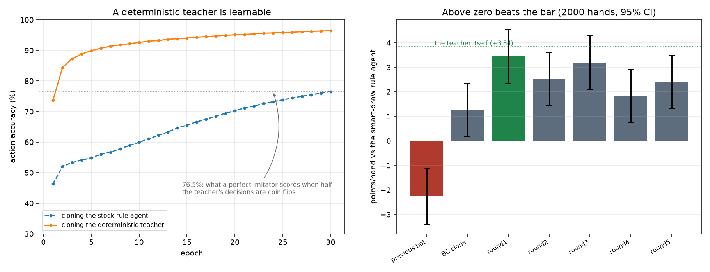

# Gin Rummy Bot — Results (v2)

**Deliverable:** `results/v2_final/gin_rummy_bot.policy.pt` (1.8 MB)

The target was a bot that beats the **smart-draw rule agent** with a 95% CI
excluding zero. The previous bot lost to it by −2.25 ± 1.14.

| Opponent | Hands | Points/hand (95% CI) | Win rate | Verdict |
|---|---:|---:|---:|---|
| **smart-draw rule agent** (the bar) | 2000 | **+2.30 ± 1.10** | 36.2% | **bot wins** |
| the previous bot | 2000 | **+7.27 ± 1.14** | 46.5% | **bot wins** |
| rlcard novice rule agent | 2000 | **+16.23 ± 1.12** | 62.3% | bot wins |
| random | 2000 | **+76.55 ± 1.11** | 99.2% | bot wins |
| the teacher it was cloned from | 2000 | −1.37 ± 1.37 | 48.4% | marginal loss |

Seats are swapped at the halfway point of every match. Scoring is the true points
scorer (gin = opponent deadwood + 25, knock = deadwood difference, undercut =
difference + 25 to the defender). Selection used seed 4242; the table above uses
seed 20250821, chosen after selection was final.



## Success criteria

| # | Criterion | Status |
|---|---|---|
| 1 | BC action accuracy clearly above 76.5% | **Met.** 96.4%, and 98.5% after DAgger. |
| 2 | Beats the smart-draw rule agent over ≥1500 hands, CI excluding zero | **Met.** +2.30 ± 1.10 over 2000 hands; +2.52 ± 1.12 on an independent held-out seed. |
| 3 | Beats `results/final/gin_rummy_bot.policy.pt` head to head over ≥1500 hands | **Met.** +7.27 ± 1.14 over 2000 hands. |

**The bot did not beat its own teacher** (−1.37 ± 1.37, a marginal loss that is
almost exactly at the significance boundary). That was expected and is stated
plainly rather than omitted.

---

## The handoff's prescription would not have worked

The handoff's theory was that the whole −2.25 gap is label noise: the stock rule
agent picks its draw by coin flip, so a clone of it copies the randomness. Its
prescription was to re-clone `SmartDraw(GinRummyNoviceRuleAgent())`.

That cannot close the gap, for a reason visible in the code. The shipped bot
already overrides its draw with `draw_decision()` in `gin_rummy_bot.py`, which is
the same rule as `SmartDraw.step` — both take the upcard only when it strictly
lowers deadwood, both with `drop_pool = hand`. **The old bot and the smart-draw
opponent already made identical draw decisions.** The entire −2.25 gap was in
discard, knock and gin. Cloning that teacher fixes the training distribution, but
a *perfect* clone of it would only tie it.

Beating the bar therefore required a teacher genuinely stronger than the bar.

## The teacher has three coin flips, not one

`GinRummyNoviceRuleAgent.step` picks randomly in three places:

| Random decision | How often | Worth fixing? |
|---|---|---|
| the draw (no branch matches, falls through to `np.random.choice`) | every turn | yes — the known +10.9 |
| discard **ties**: `_get_best_discards` returns every tied-best card | **40.6%** of discards, mean 1.64 options | for learnability, not strength |
| which `KnockAction` to play, among a mean of **2.5** legal ones | every knock | for learnability, not strength |

The last two are new findings; the handoff documents only the draw. Fixing both
is worth **+0.14 ± 1.14** points/hand on its own — nothing. But making them
deterministic is what lets a clone reach 96% instead of 76% accuracy, and it also
removes the opponent weakness discussed under *Limitations* below.

## Where the strength actually came from: knock timing

The handoff assumed knocking is strong in this engine because rlcard implements
no lay-offs. **The opposite is true.** Against an opponent that knocks at the
first legal chance, holding for gin banks the +25 gin bonus and converts the
opponent's early knocks into +25 undercuts. Sweeping the knock threshold, 1000
hands each vs `SmartDraw(rule)`:

| Knock when deadwood ≤ | Points/hand |
|---:|---:|
| 10 (the stock behaviour) | +0.90 ± 1.39 |
| 8 | +0.17 ± 1.29 |
| 6 | +0.52 ± 1.39 |
| 4 | +0.49 ± 1.42 |
| 2 | +2.12 ± 1.52 |
| **0 (never knock, gin only)** | **+3.77 ± 1.59** |

This works because rlcard scores a dead hand as **0 for both players**. Holding
costs nothing but the knock points forgone, so there is no downside to insure
against — and the insurance rule (`endgame_stock`, knock anyway once the stock
runs low) measured *worse* than not having it.

Patience is also not fragile against a passive opponent, which was the obvious
worry. Against a random opponent the patient teacher reaches **gin in 90.2% of
hands with 0.0% dead hands**, where the smart-draw rule agent gins 1.9% and knocks
98.1%.

## Method

**Stage 1 — `teacher.py`.** One deterministic `StrongTeacher`: patient knocking,
min-deadwood knock selection, deterministic discard tie-breaks, smart draws. All
parameterised.

**Stage 2 — `tune_teacher.py`.** Coordinate descent over six integers, scored on
the true points scorer with common random numbers. The panel is
`SmartDraw(rule)`, the stock rule agent, random, **and the incumbent patient
teacher** — the fourth is the guard, because the first three all knock
immediately and a panel without a patient opponent would reward patience for
exploiting one habit. `random` is excluded from the objective (everything beats
it by 50–80 points, which would swamp the differences that matter) and kept as a
tripwire for dead-handing.

Top finalists were re-scored on a **held-out seed at 3000 hands/opponent**. The
winner scored **+3.84 ± 0.92** vs the bar against **+3.11 ± 0.91** for the
hand-picked prototype. A second full run, with the tuned config now sitting in
the panel as the patient opponent, found nothing better than noise (+3.29 ± 0.93
for a config differing only in `w_live`). Raw log: `results/v2_tuning.csv`.

**Stage 3 — behaviour cloning** (`pretrain.py --teacher strong --bc_only`).
16 000 noisy-teacher episodes (executed action deviates 15% of the time for state
coverage; the label is always the teacher's), 908 k decisions, 30 epochs.
**96.4% action accuracy**, against 76.5% for the old teacher. `--bc_only` also
skips the DQN replay and reservoir seeding that the NFSP path needs and this
pipeline never touches: a 1.8 MB file instead of 654 MB, and a much shorter
roll-out.

**Stage 4 — DAgger** (`dagger.py --teacher strong --eval_opponent smart`).
5 rounds × 8000 episodes, roll-in split across self / random / stock-rule /
teacher opponents, dataset the union of expert and clone-visited data. Two
changes from v1 mattered: the per-round benchmark now scores against the actual
bar rather than the stock rule agent, and the patient teacher was added to the
roll-in mix so the clone sees the long hands it produces. Accuracy 98.5%.

**Stage 5 — selection** (`select_final.py`). Every round re-scored at 2000 hands
in both modes; the winner re-scored on a different seed.

| Candidate (greedy) | vs the bar, 2000 hands |
|---|---:|
| BC clone | +1.25 ± 1.08 |
| **round 1** | **+3.44 ± 1.10** |
| round 2 | +2.52 ± 1.09 |
| round 3 | +3.19 ± 1.10 |
| round 4 | +1.83 ± 1.08 |
| round 5 | +2.40 ± 1.09 |

Round 1 greedy was selected at +3.44 and scored **+2.52 ± 1.12** on the held-out
seed. That drop is the winner's curse; the held-out number is the honest one.
Every candidate beat the bar, so the result does not depend on the selection.

## The knock timing is in the network, not in a rule

The requirement was that the new strength come out of the network rather than a
second hand-written override. It did. Probing 400 hands against the bar and
counting what the policy does when a knock is legal and gin is not:

| Bot | Legal knocks offered | Declined | Median deadwood when offered |
|---|---:|---:|---:|
| **v2 (this bot)** | 576 | **100.0%** | 6 |
| v1 (previous bot) | 288 | 44.8% | 8 |

The v2 network declines every one of 576 opportunities, with no rule telling it
to — `draw_decision()` only touches the draw. It is also offered twice as many,
because it keeps hands alive instead of ending them.

## The bot is now essentially a pure network

The previous bot was a network plus a hand-written draw rule, and the honest
reading was that most of its margin came from the rule. That is no longer true:

| Configuration | vs the bar | vs stock rule | vs random |
|---|---:|---:|---:|
| network + `draw_decision()` (shipped) | +2.30 ± 1.10 | +16.23 ± 1.12 | +76.55 ± 1.11 |
| **network alone**, no hand-written rule | **+1.89 ± 1.11** | +14.69 ± 1.13 | +74.48 ± 1.21 |

The draw override is now worth **+0.41**, down from about +11 for the previous
bot, because the network learned the draw rule itself. **The network alone beats
the bar** (+1.89 ± 1.11). The override is kept on by default because it measures
slightly better and costs nothing, but the result no longer depends on it.

## Limitations

- **Much of the margin over the bar is an exploit of the bar's random knock
  selection.** The bot ties an opponent that is otherwise identical to the bar but
  picks its minimum-deadwood knock instead of a random one:

  | Opponent | Points/hand | Bot's undercut rate |
  |---|---:|---:|
  | `SmartDraw(rule)` — random knock choice | +2.27 ± 1.44 | 30.6% |
  | same, but min-deadwood knock choice | +0.02 ± 1.39 | 23.9% |

  A random knock choice means knocking with more deadwood than necessary, which
  the patient bot converts into undercuts. Note this makes the field
  non-transitive: the two opponents above are themselves a statistical tie
  (+0.14 ± 1.14), yet the bot scores +2.27 against one and +0.02 against the
  other.

- **Across the knock spectrum the bot is roughly even, not dominant.** Against
  deterministic opponents at knock thresholds 10 / 5 / 2 it scores +0.13 ± 1.25,
  +0.55 ± 1.22 and −0.13 ± 1.37 — three statistical ties (1500 hands each).

- **It has not caught its teacher** (−1.37 ± 1.37).

- **The patient strategy is specific to this engine.** A dead hand scoring 0 for
  both players, and the absence of lay-offs, are what make holding for gin free.
  Under paper rules it would be a much worse idea.

- **Greedy play is deterministic** and so more exploitable by an *adaptive*
  opponent. `greedy=False` costs about 1 point/hand against the fixed opponents
  tested.

- **Its play is teacher-shaped.** The network reached the teacher's level by
  imitation, not by discovering strategy. The knock-timing insight came from a
  parameter sweep I ran, not from the network.

---

## Carried over from v1 (still true, do not re-test)

**Reinforcement learning does not work in this environment from scratch.** Six
configurations were tested; every one ended worse than its own random
initialisation (knock rate 7% → 2%, dead hands 91% → 97%).

| Tried | Result |
|---|---|
| NFSP self-play | flat in **both** networks over a 150k-episode attempt |
| DQN, lr 1e-4 / 1e-3 | worse than random init |
| DQN, `train_every` 1 and 4 | worse than random init |
| DQN, γ=1.0 + fast target updates | worse than random init |
| Potential-based shaping alone | helps (−0.489 → −0.367), nowhere near enough |
| NFSP warm-started from a good clone | **degraded it monotonically**: +0.443 → +0.270 vs random |
| Policy gradient from the clone | oscillated −5.69 to −7.80 over 8000 episodes, no trend |

**Why:** knocking only becomes legal once deadwood drops to 10, which random
exploration reaches in ~7% of hands, so the DQN almost never observes the reward
for going out. For NFSP specifically, a warm-started agent's average policy
knocked 74.7% of hands while its own DQN knocked 2.0% — and NFSP trains the
average policy to imitate that DQN.

**It is not the representation.** Behaviour cloning with the identical 5×52
observation, 110-action space and network reached −0.169 vs random where RL
managed −0.55.

Also verified and unchanged: the custom points scorer is exactly zero-sum;
random self-play dead-hands 97.25% of the time; gin rummy's double-actions
interleave correctly through `Env.run` and `reorganize`; rlcard's gin rummy has
**no lay-offs**, which is an engine limitation, not a bug to fix in the scorer.

## Files

| File | Purpose |
|---|---|
| `results/v2_final/gin_rummy_bot.policy.pt` | **the bot** (1.8 MB) |
| `results/v2_final/benchmark.md` | final benchmark table |
| `results/v2_final/benchmark_network_only.md` | the same without the draw override |
| `results/v2_final/v2_results.png` | the figure above |
| `teacher.py` | `StrongTeacher` — the deterministic, tuned teacher |
| `tune_teacher.py` | the parameter search and its opponent panel |
| `pretrain.py` | behaviour cloning (`--teacher`, `--bc_only`) |
| `dagger.py` | DAgger (`--teacher`, `--eval_opponent`, `--diverse_rollin`) |
| `select_final.py` | high-power selection with a held-out re-score |
| `gin_rummy_bot.py` | `GinRummyBot` wrapper + `draw_decision()` |
| `smart_draw.py` | the bar (`SmartDraw`) and the original isolation experiment |
| `head_to_head.py`, `benchmark.py` | seat-swapped matches with 95% CIs |
| `play_vs_bot.py` | play against it in the terminal |
| `train_gin_rummy.py` | the NFSP trainer — works, just does not learn this game |
| `results/v2_*.log`, `results/v2_tuning.csv` | raw evidence for every number above |

## Reproducing

```bash
python tune_teacher.py --hands 1000 --sweeps 3 --workers 12 --validate_hands 3000
python pretrain.py --teacher strong --bc_only --episodes 16000 --epochs 30 --out results/v2_bc.policy.pt
python dagger.py --teacher strong --eval_opponent smart --rounds 5 --seed_episodes 10000 --episodes_per_round 8000 --epochs 15 --diverse_rollin --num_eval_games 500 --init results/v2_bc.policy.pt --out results/v2_dagger
python select_final.py --dir results/v2_dagger --extra results/v2_bc.policy.pt --vs smart --num_games 2000
python benchmark.py results/v2_final/gin_rummy_bot.policy.pt --greedy --num_games 2000 --seed 20250821 --vs smart rule random strong results/final/gin_rummy_bot.policy.pt
```
